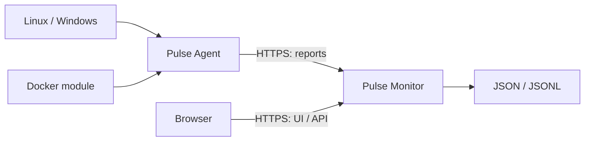

# Pulse Monitor

[Pulse website](https://pulse.hubba-cloud.ru/en/) · [Practical guides](https://pulse.hubba-cloud.ru/en/guides/)

[Русский](README.md) · **English**

[](https://github.com/HubbaBubbaPrepod/pulse-monitor/actions/workflows/ci.yml)
[](https://github.com/HubbaBubbaPrepod/pulse-monitor/releases)
[](LICENSE)

[Quick start](#quick-start) · [Documentation](#documentation) · [Development](#development) · [Issues](https://github.com/HubbaBubbaPrepod/pulse-monitor/issues)

Self-hosted dashboard for Linux and Windows hosts: CPU, memory, processes, disks, available GPU metrics, connections, logs, and events. A native Go server serves the web UI and API; real nodes send telemetry through Pulse Agent. An empty installation waits for agents.

## Pulse ecosystem

| Repository                                                                     | Purpose                                                                   | Release |
| ------------------------------------------------------------------------------ | ------------------------------------------------------------------------- | ------- |
| [Pulse Monitor](https://github.com/HubbaBubbaPrepod/pulse-monitor)             | Dashboard, API, and storage; native archives include the Go server and UI | v0.4.0  |
| [Pulse Agent](https://github.com/HubbaBubbaPrepod/pulse-agent)                 | Linux/Windows collectors with outbound HTTPS reporting                    | v0.4.0  |
| [Pulse Module Docker](https://github.com/HubbaBubbaPrepod/pulse-module-docker) | Optional JSON package for Docker Engine                                   | v1.0.2  |



## Quick start

1. Download your platform archive and `checksums.txt` from [Releases](https://github.com/HubbaBubbaPrepod/pulse-monitor/releases). Linux amd64/arm64 and Windows amd64 are supported. Verify SHA-256 as described in the [installation guide](docs/INSTALL.en.md), then extract the entire archive: the executable needs the adjacent `out` directory. Prebuilt releases require neither Go nor Node.js.
2. Start from the extracted directory:

   ```text
   ./pulse-monitor -addr 127.0.0.1:8080 -data data -static out
   ```

   In PowerShell, use `./pulse-monitor.exe`. Open `http://127.0.0.1:8080/register/` and register the owner. For a remote server, use `ssh -L 8080:127.0.0.1:8080 user@server`, then open the same local URL. Remote startup is rejected until the owner is registered.

3. Stop the program and enable HTTPS with your domain's certificate:

   ```text
   ./pulse-monitor -addr 0.0.0.0:8443 -data data -static out -tls-cert fullchain.pem -tls-key privkey.pem -public-url https://monitor.example.com:8443
   ```

4. Open the HTTPS address, sign in, and add a node. Create a token in the saved node's settings. Save it on the node in a protected `agent.token` file without quotes. Linux: `chmod 600 agent.token`; Windows: restrict ACLs to the service account, SYSTEM, and administrators.
5. Download [Pulse Agent](https://github.com/HubbaBubbaPrepod/pulse-agent/releases) and start it:

   ```text
   ./pulse-agent -url https://monitor.example.com:8443 -server SERVER_ID -token-file agent.token -state agent-state
   ```

   The agent sends reports outbound; the monitored node needs no inbound port. Access the dashboard remotely through HTTPS.

## Features and limits

- Live metrics and charts, sortable/searchable processes, disks, filtered logs with CSV export, connection and load events.
- NVIDIA through available `nvidia-smi`; some Windows metrics through CIM/GPU Engine. Availability depends on the driver and OS; full Intel/AMD telemetry is not guaranteed. Unavailable values display a dash.
- Connections and addresses need no additional programs. Packet metadata requires separately installed TShark and capture privileges; Windows also needs Npcap. Packet contents are not retained and packets are not mapped to PIDs.
- Russian/English UI, themes and custom palettes with JSON import/export; owner preferences persist on the server.
- Experimental modules: JSON packages containing native collectors, settings, and views. Modules run arbitrary code with agent permissions and no sandbox. Upload only trusted packages.

The Docker collector releases separately as [Pulse Module Docker](https://github.com/HubbaBubbaPrepod/pulse-module-docker). Upload the v1.0.2 `docker-module.json` package in module settings, then enable it for the target node.

The dashboard and agent release independently. Use both at `v0.4.0` for the first public release; report and module contracts are described as v1. Before v1.0, compatibility with future versions is not guaranteed; changes will be recorded in the changelog. The server stores JSON/JSONL without automatic archive retention limits: monitor free disk space.

## Documentation

| Guide                                           | Contents                                              |
| ----------------------------------------------- | ----------------------------------------------------- |
| [Installation](docs/INSTALL.en.md)              | Archives, checksums, owner, HTTPS, and services       |
| [Operations](docs/OPERATIONS.en.md)             | Data, backups, upgrades, removal, and troubleshooting |
| [Modules](docs/MODULES.en.md)                   | Package format, limits, trust, and Docker             |
| [Protocol](docs/PROTOCOL.en.md)                 | Agent reports, owner API, and compatibility           |
| [Translations](docs/TRANSLATIONS.en.md)         | UI dictionaries and paired documentation              |
| [Changelog](CHANGELOG.md)                       | Public releases and limitations                       |
| [Support](SUPPORT.md) / [Security](SECURITY.md) | Questions and vulnerability reporting                 |

## Development

Requirements: Node.js 22.13+ and Go 1.23+. Platform packaging also requires PowerShell 7.4+ (`pwsh`); Go must be in PATH or supplied using `-GoExe`. From the repository root:

```powershell
npm ci
npm run dev
```

In a second terminal:

```powershell
cd backend
go run . -data ../data -static ../out
```

UI: `http://127.0.0.1:3000`; API: `http://127.0.0.1:8080`. Production packaging: `./scripts/build.ps1 -Version v0.4.0`. The agent lives in its own repository.

## Contributing and license

The [code of conduct](CODE_OF_CONDUCT.md) applies throughout project spaces.

The [contributor guide](CONTRIBUTING.md) describes checks and the change process. Report problems through [Issues](https://github.com/HubbaBubbaPrepod/pulse-monitor/issues), including versions and redacted logs.

Code is licensed under [MIT](LICENSE). Brand icons: [Simple Icons](https://github.com/simple-icons/simple-icons), CC0; other icons: [Lucide](https://github.com/lucide-icons/lucide), ISC. Dependencies retain their own licenses.

SQLite storage, upgrades and backups: [documentation](docs/STORAGE.en.md).
