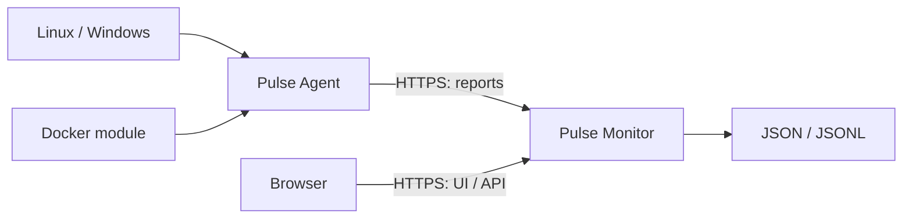

# Pulse Monitor

**Русский** · [English](README.en.md)

[](https://github.com/HubbaBubbaPrepod/pulse-monitor/actions/workflows/ci.yml)
[](https://github.com/HubbaBubbaPrepod/pulse-monitor/releases)
[](LICENSE)

[Быстрый старт](#быстрый-старт) · [Документация](#документация) · [Разработка](#разработка) · [Issues](https://github.com/HubbaBubbaPrepod/pulse-monitor/issues)

Pulse Monitor — панель самостоятельного размещения: CPU, память, процессы, диски, доступные GPU-показатели, соединения, журналы и события. Данные поступают от реальных узлов; пустая установка ждёт подключения агентов.

## Экосистема Pulse

| Репозиторий | Назначение | Выпуск |
| --- | --- | --- |
| [Pulse Monitor](https://github.com/HubbaBubbaPrepod/pulse-monitor) | Панель, API и хранение данных; готовый архив включает Go-сервер и UI | v0.4.0 |
| [Pulse Agent](https://github.com/HubbaBubbaPrepod/pulse-agent) | Сборщики Linux/Windows, исходящая отправка по HTTPS | v0.4.0 |
| [Pulse Module Docker](https://github.com/HubbaBubbaPrepod/pulse-module-docker) | Необязательный JSON-пакет для Docker Engine | v1.0.2 |



## Быстрый старт

1. Скачайте архив для своей платформы и `checksums.txt` из [Releases](https://github.com/HubbaBubbaPrepod/pulse-monitor/releases). Сверьте SHA-256 по [руководству установки](docs/INSTALL.md), затем распакуйте. Поддерживаются Linux amd64/arm64 и Windows amd64. Распакуйте архив целиком: рядом с программой нужен каталог `out`. Go и Node.js для запуска готовой сборки не нужны.
2. Запустите из каталога архива:

   ```text
   pulse-monitor -addr 127.0.0.1:8080 -data data -static out
   ```

   В PowerShell используйте `./pulse-monitor.exe`. Откройте `http://127.0.0.1:8080/register/` и создайте владельца. На удалённом сервере используйте SSH-туннель: `ssh -L 8080:127.0.0.1:8080 user@server`, затем откройте тот же локальный URL. Удалённый запуск до регистрации владельца отклоняется.
3. Остановите программу и включите HTTPS с сертификатом своего домена:

   ```text
   pulse-monitor -addr 0.0.0.0:8443 -data data -static out -tls-cert fullchain.pem -tls-key privkey.pem -public-url https://monitor.example.com:8443
   ```

4. Откройте HTTPS-адрес, войдите и добавьте узел. В настройках сохранённого узла создайте токен. Сохраните его на узле в защищённый файл `agent.token` без кавычек. Linux: `chmod 600 agent.token`; Windows: ограничьте ACL учётной записью службы, SYSTEM и администраторами.
5. Скачайте [Pulse Agent](https://github.com/HubbaBubbaPrepod/pulse-agent/releases) и запустите:

   ```text
   pulse-agent -url https://monitor.example.com:8443 -server SERVER_ID -token-file agent.token -state agent-state
   ```

   Агент отправляет отчёты сам; входящий порт на узле не нужен. Панель доступна удалённо по HTTPS.

[Установка и службы](docs/INSTALL.md) · [Обновление, backup и диагностика](docs/OPERATIONS.md) · [Модули](docs/MODULES.md) · [Протокол](docs/PROTOCOL.md) · [Переводы](docs/TRANSLATIONS.md)

## Возможности и ограничения

- Текущие показатели и графики, процессы с сортировкой и поиском, диски, журналы с фильтрами и CSV, события подключения и нагрузки.
- NVIDIA через доступный `nvidia-smi`; часть Windows-показателей через CIM/GPU Engine. Поддержка зависит от драйвера и ОС; Intel/AMD не имеют полноценной гарантированной телеметрии. Недоступное показано прочерком.
- Соединения и адреса без дополнительных программ. Метаданные пакетов требуют отдельно установленного TShark и прав захвата; Windows также требует Npcap. Содержимое пакетов не сохраняется, привязка пакета к PID не выполняется.
- Русский/английский интерфейс, темы и пользовательские палитры с импортом/экспортом JSON; настройки владельца сохраняются на сервере.
- Экспериментальные модули: JSON-пакет с нативными сборщиками, настройками и представлениями. Модуль выполняет произвольный код с правами агента, без песочницы. Загружайте только доверенные пакеты.

Docker-сборщик выпускается отдельно: [Pulse Module Docker](https://github.com/HubbaBubbaPrepod/pulse-module-docker). Готовый `docker-module.json` v1.0.2 загружается в настройки модулей; затем включите его для нужного узла.

Панель и агент выпускаются независимо. Для первого публичного выпуска используйте обе версии `v0.4.0`; контракт отчётов и модулей описан как v1. До v1.0 совместимость будущих версий не гарантируется; изменения будут указаны в changelog. Сервер хранит JSON/JSONL без автоматического ограничения архива — контролируйте свободное место.

## Документация

| Руководство | Что внутри |
| --- | --- |
| [Установка](docs/INSTALL.md) | Архивы, контрольные суммы, владелец, HTTPS и службы |
| [Эксплуатация](docs/OPERATIONS.md) | Данные, backup, обновление, удаление и диагностика |
| [Модули](docs/MODULES.md) | Формат пакета, лимиты, доверие и Docker |
| [Протокол](docs/PROTOCOL.md) | Отчёты агента, API владельца и совместимость |
| [Переводы](docs/TRANSLATIONS.md) | Словари интерфейса и парная документация |
| [История изменений](CHANGELOG.ru.md) | Публичные выпуски и ограничения |
| [Поддержка](SUPPORT.ru.md) / [Безопасность](SECURITY.ru.md) | Обращения и сообщения об уязвимостях |

## Разработка

Нужны Node.js 22.13+ и Go 1.23+. Для скрипта платформенной сборки также нужен PowerShell 7.4+ (`pwsh`); Go должен быть в PATH или указан через `-GoExe`. Из корня:

```powershell
npm ci
npm run dev
```

Во втором терминале:

```powershell
cd backend
go run . -data ../data -static ../out
```

UI: `http://127.0.0.1:3000`, API: `http://127.0.0.1:8080`. Production-сборка: `./scripts/build.ps1 -Version v0.4.0`. Агент находится в отдельном репозитории.

## Участие и лицензия

[Правила поведения](CODE_OF_CONDUCT.ru.md) действуют во всех пространствах проекта.

[Руководство участника](CONTRIBUTING.ru.md) описывает проверки и процесс изменений. Сообщайте о проблемах через [Issues](https://github.com/HubbaBubbaPrepod/pulse-monitor/issues), приложив версию и обезличенные журналы.

Код распространяется под [MIT](LICENSE). Иконки брендов: [Simple Icons](https://github.com/simple-icons/simple-icons), CC0; остальные — [Lucide](https://github.com/lucide-icons/lucide), ISC. Зависимости сохраняют собственные лицензии.
